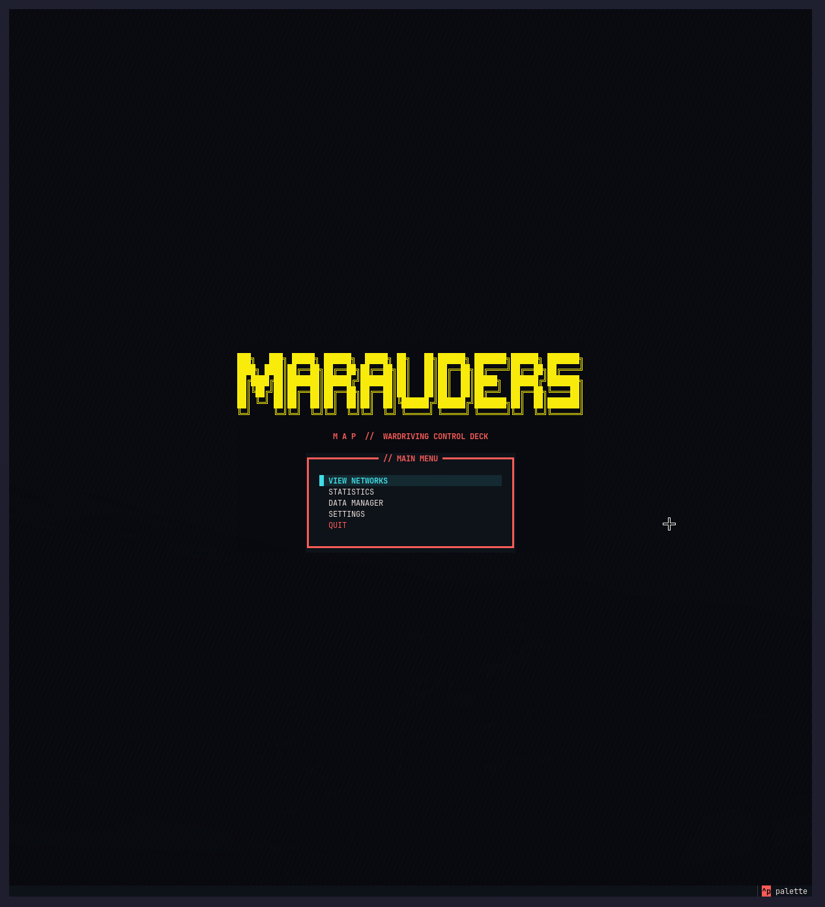

# Marauder's Map

A local wardriving tool. It imports `.bin` capture files (MMAP format) into one
SQLite database per city, then lets you browse the Wi-Fi networks and their
observations from a terminal (TUI) or a browser (GUI).

Everything runs locally. The GUI has no login and only listens on `127.0.0.1`.



## Features

- **Networks** — list of detected networks; open one to see all its observations
  (time, GPS position, signal).
- **Statistics** — totals and encryption breakdown for a database.
- **Data Manager** — import a capture, create a database, view imported files,
  delete one database or all of them.
- **Map** (GUI only) — each network placed at its strongest GPS observation.

Both interfaces share the same data and features.

## Installation

Tested with Python 3.15.

```bash
python -m venv .venv
.venv/bin/pip install -r requirements.txt
mkdir -p data/maps
```

Run all commands from the project root: `data/` is a relative path.

## Usage

```bash
.venv/bin/python main.py      # terminal (TUI)
.venv/bin/python -m gui       # browser: http://127.0.0.1:8000 (--port to change)
```

To add a capture: **Data Manager → Import file**, select the file and enter the
city name. The database `data/<city>.db` is created if it doesn't exist, and a
file that was already imported is skipped (matched by SHA-256 hash).

## Map

Each map zone is one `.pmtiles` file in `data/maps/`, which works offline once
downloaded. Install the
[`pmtiles` tool](https://github.com/protomaps/go-pmtiles/releases), pick a recent
build date from the
[list of builds](https://build-metadata.protomaps.dev/builds.json), then extract
a zone with `--bbox=<west>,<south>,<east>,<north>`.

Example — Lille metropolitan area (~56 MB):

```bash
pmtiles extract https://build.protomaps.com/YYYYMMDD.pmtiles data/maps/mel.pmtiles \
  --bbox=2.76,50.48,3.30,50.81 --maxzoom=15
```

The file name becomes the zone name; each file in the folder appears in the Map
view. The map style is defined in `gui/static/map/style.json`.

On the map, a network is placed at its **strongest observation with a GPS fix** —
an approximation of where it was heard, **not** the location of the access point.

Map data: © [OpenStreetMap](https://openstreetmap.org/copyright) contributors,
via [Protomaps](https://protomaps.com).

## Documentation

- [Data format](docs/data-format.md) — binary capture format, 802.11 decoding,
  SQLite schema.
- [Hardware](docs/hardware.md) — nodes/core architecture, BOM, wiring, firmware.
- [Roadmap](docs/roadmap.md) — planned features.

## Project layout

```text
core/    capture file reader and 802.11 frame decoder
models/  data classes (Metadata, Network)
db/      SQLite access and import logic
tui/     terminal interface (Textual)
gui/     browser interface (FastAPI, HTMX, MapLibre)
data/    databases and map zones (not versioned)
docs/    documentation
```

## Roadmap

- Manufacturer enrichment (OUI / BLE Company ID lookup)
- WPA2 vs WPA3 distinction (RSN AKM suites)
- Multi-node handling
- 5 GHz and BLE capture
- Truncated-file recovery tool
- Exports


*License MIT*