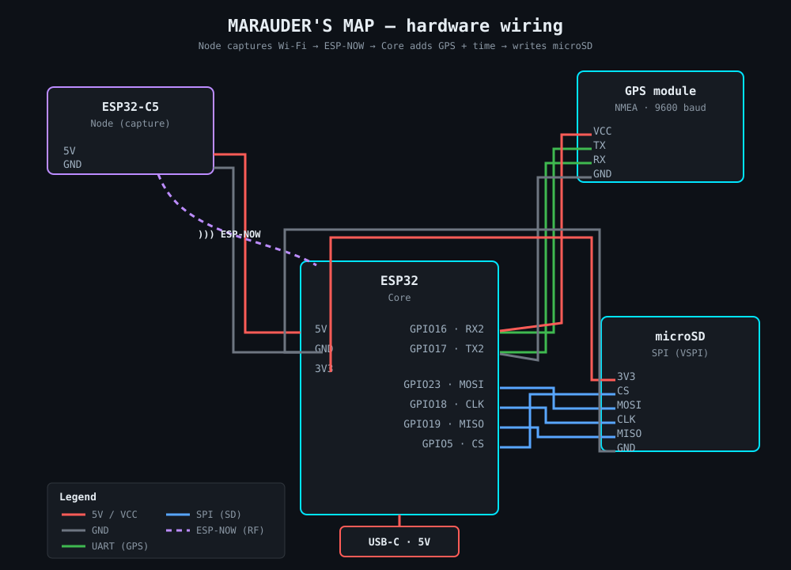

# Hardware

Marauder's Map captures Wi-Fi frames with custom ESP32 hardware, then stores
them on a microSD card in the [MMAP format](data-format.md). This page covers
the architecture, wiring, bill of materials, and firmware.

## Overview

The system has two roles:

- **Node(s)** — ESP32-C5 in Wi-Fi promiscuous mode. They capture surrounding
  802.11 management frames (beacons) and forward them, untouched, over
  **ESP-NOW** (wireless).
- **Core** — ESP32 that receives the frames over ESP-NOW, adds context (signal,
  channel, band, GPS position, UTC timestamp), and writes each record to the
  microSD card.

Keeping the Core as the only unit with GPS and storage keeps the Nodes simple,
and preserves the raw frame: decoding happens later, in the desktop/GUI app.

> ESP-NOW is used in its v2 variant, which allows payloads larger than the
> 250-byte v1 limit — necessary because management frames can exceed that. The
> Node fragments a frame if needed and the Core reassembles it before writing.

## Wiring

> ⚠️ Pins below come from the Core firmware and the wiring sketch — verify
> against your actual build, especially the GPS TX/RX crossing. The sketch
> uses an ESP32 WROOM DevKit for the Core (prototype); GPIO numbers may differ
> on a C5 board.

**GPS ↔ Core (UART2, 9600 baud)**

| GPS pin | Core pin     | Role         |
| ------- | ------------ | ------------ |
| VCC     | 5V           | power        |
| GND     | GND          | ground       |
| TX      | GPIO16 (RX2) | GPS → Core   |
| RX      | GPIO17 (TX2) | Core → GPS   |

**microSD ↔ Core (SPI / VSPI)**

| SD pin | Core pin | Role        |
| ------ | -------- | ----------- |
| 3V3    | 3V3      | power       |
| GND    | GND      | ground      |
| CS     | GPIO5    | chip select |
| MOSI   | GPIO23   | data → SD   |
| CLK    | GPIO18   | SPI clock   |
| MISO   | GPIO19   | data ← SD   |

**Node ↔ Core** — 5V and GND shared from the Core; data is wireless (ESP-NOW),
no signal wires.

## Bill of materials

> _To complete with your exact references._

| Component       | Role                     | Model / ref        | Qty |
| --------------- | ------------------------ | ------------------ | --- |
| ESP32-C5        | Node (Wi-Fi capture)     | _…_                | _N_ |
| ESP32 (C5)      | Core (GPS + SD)          | _…_                | 1   |
| GPS module      | position (NMEA, UART)    | _…_                | 1   |
| microSD module  | storage (SPI)            | _…_                | 1   |
| microSD card    | capture storage          | _…_                | 1   |
| Antennas        | 2.4 GHz (and 5 GHz)      | _…_                | _…_ |
| Power           | USB-C, 5V                | _…_                | 1   |

## Firmware (Core)

C++ on ESP-IDF. Three FreeRTOS tasks:

- **`gps_task`** — reads NMEA sentences on UART2, parses `$GxRMC` to keep the
  current position (`lat_e7`, `lon_e7`) and UTC epoch. Coordinates are stored
  as degrees ×1e7 (integers).
- **`recv_cb`** (ESP-NOW callback) — reassembles fragmented frames, then builds
  a record: Node metadata + current GPS (0 if no fix) + the raw frame, and
  queues it.
- **`sd_task`** (pinned to core 1) — mounts the SD over SPI, auto-names the file
  `capture_NNN.bin`, writes the MMAP header once, then appends each record and
  flushes to the card every 20 records (`fflush` + `fsync`). A `lost` counter
  tracks frames dropped (reassembly error or full queue).

Each record on the card is `mm_meta_t` (metadata, 18 bytes, `frame_len`
included) followed by the raw frame — see [data format](data-format.md).

## Photos

> TODO: _Add photos of the build here: `docs/images/node.jpg`, `docs/images/core.jpg`,
> `docs/images/assembled.jpg`._
>
> ``