# Marauder's Map — Technical Documentation

## Contents

1. [Project overview and how to read this document](#1-project-overview-and-how-to-read-this-document)
2. [User stories and mockups](#2-user-stories-and-mockups)
3. [System architecture](#3-system-architecture)
4. [Components, classes and database design](#4-components-classes-and-database-design)
5. [Sequence diagrams](#5-sequence-diagrams)
6. [API specifications](#6-api-specifications)
7. [SCM and QA plans](#7-scm-and-qa-plans)
8. [Technical justifications](#8-technical-justifications)
9. [Known limitations and next steps](#9-known-limitations-and-next-steps)

---

## 1. Project overview and how to read this document

### 1.1 Purpose

Marauder's Map records the Wi-Fi networks heard during a trip and lets its owner
explore them afterwards. Custom ESP32 hardware captures 802.11 beacon frames,
tags them with a GPS position and writes them to a microSD card. The software
documented here imports those capture files into local databases and presents
the results in a terminal interface (TUI) or a browser interface (GUI).

Capture is passive: the hardware only listens to beacons that access points
broadcast. The project does not connect to networks or attack them.

### 1.2 Scope

| In scope | Out of scope |
| --- | --- |
| Importing `.bin` capture files (MMAP format) | Live capture or streaming to the app |
| One SQLite database per city | Multiple users, accounts, permissions |
| Browsing networks, observations and statistics | Hosting on a server or in the cloud |
| Offline map of the networks (GUI) | Any active action on a Wi-Fi network |

### 1.3 A standalone application, not a hosted web application

The expected deliverables usually assume a client, a remote server and a hosted
database. Marauder's Map runs entirely on the user's machine, so each item is
adapted as follows.

| Usual web project | This project | Where it is covered |
| --- | --- | --- |
| Remote back-end | Python modules in the same project, loaded by each interface | [§3](#3-system-architecture) |
| Single front-end | Two interfaces over the same data: Textual TUI and local web GUI | [§2.3](#23-interface-coverage) |
| Database server | SQLite files in `data/`, no server process | [§4.3](#43-database-design) |
| Public REST API | A local HTTP interface, mostly HTML, reachable on `127.0.0.1` only | [§6.2](#62-internal-http-interface-gui) |
| Internal service calls | Direct Python calls to `db.database` | [§6.3](#63-internal-python-api-tui-and-gui) |
| Third-party API calls | None at runtime; the map is a local file | [§6.1](#61-external-apis) |
| Accounts and sessions | None: one local user, protected by the local network boundary | [§3.4](#34-security-boundary) |
| Deployment pipeline | Local install with a virtual environment | [§3.3](#33-deployment-view) |

### 1.4 Status conventions

The document separates what exists from what is planned:

- ✅ **Implemented**: present in the code baseline.
- ⚠️ **Partial**: works, with a limitation listed in [§9.1](#91-known-defects).
- 📋 **Planned**: not implemented.

---

## 2. User stories and mockups

### 2.1 Persona

**The solo wardriver** is a technical hobbyist or security student who owns the
capture hardware. They want to know which networks are around them, how they are
secured and where they were heard, without sending location data to a third party.

### 2.2 Prioritized user stories

Priorities use the MoSCoW method.

#### Must have

| ID | Story | Acceptance criteria | Status |
| --- | --- | --- | --- |
| US-01 | As a wardriver, I want to import a capture file into a city database, so that my data can be explored. | The file header is validated. Frames are decoded into networks and observations. The database is created if needed. | ⚠️ D2, D3 |
| US-02 | As a wardriver, I want a file that was already imported to be skipped, so that observations are not duplicated. | A file with the same SHA-256 hash is refused for that database, and the user is told. | ✅ |
| US-03 | As a wardriver, I want to list the detected networks, so that I can see what was captured. | Each row shows BSSID, SSID and encryption. Hidden networks are identifiable. | ⚠️ D1 |
| US-04 | As a wardriver, I want to open a network and see its observations, so that I can see when and where it was heard. | Each observation shows time, latitude, longitude and RSSI. Observations without a GPS fix remain visible. | ✅ |
| US-05 | As a wardriver, I want statistics for a database, so that I can summarize a trip. | Totals of networks, observations and hidden networks, plus a breakdown by encryption. | ⚠️ D1 |
| US-06 | As a wardriver, I want all of this to work without an internet connection or an account, so that my data stays on my machine. | No request leaves the machine at runtime. The GUI only listens on `127.0.0.1`. | ✅ |

#### Should have

| ID | Story | Acceptance criteria | Status |
| --- | --- | --- | --- |
| US-07 | As a wardriver, I want to choose between a terminal and a browser, so that I can use the tool in either context. | Both interfaces read the same databases. | ✅ |
| US-08 | As a wardriver, I want to see networks on a map, so that I understand their geographic distribution. | Each network with a GPS fix is placed at its strongest observation. Dense areas are clustered. | ✅ GUI |
| US-09 | As a wardriver, I want to filter the map by encryption level, so that I can spot open or weak networks. | Secure, weak and open networks can be toggled. Clusters and counters follow the filter. | ✅ GUI |
| US-10 | As a wardriver, I want to search and page through networks, so that large lists stay usable. | Search matches BSSID, SSID or encryption. Results are shown 50 per page. | ✅ GUI |
| US-11 | As a wardriver, I want to create and delete databases and view imported files, so that I can manage my data. | Deletion always asks for confirmation. | ⚠️ D4, D5, D6 |
| US-12 | As a keyboard user, I want to navigate without a mouse, so that I can work quickly. | Arrows, Enter and Escape work in both interfaces. The map view remains mouse-oriented. | ✅ |

#### Could have (planned)

| ID | Story | Status |
| --- | --- | --- |
| US-13 | As a wardriver, I want to export data as CSV, GeoJSON or KML, so that I can reuse it elsewhere. | 📋 |
| US-14 | As a wardriver, I want to see each network's manufacturer (OUI lookup). | 📋 |
| US-15 | As a wardriver, I want WPA2 and WPA3 reported separately. | 📋 |
| US-16 | As a wardriver, I want to capture and filter 5 GHz, BLE and multi-node data. | 📋 |
| US-17 | As a wardriver, I want to recover the valid part of a truncated capture. | 📋 |

#### Won't have (in this version)

- Accounts, sharing or any multi-user feature.
- Hosted deployment or synchronization between devices.
- Live display during capture.
- Connection to, or attacks on, the detected networks.

### 2.3 Interface coverage

| Feature | TUI | GUI |
| --- | --- | --- |
| Networks and observations | ✅ | ✅ |
| Statistics | ✅ | ✅ with share and distribution |
| Data manager (import, create, imported files, delete) | ✅ | ✅ |
| Search and pagination | — (scrollable table) | ✅ |
| Map | — | ✅ |
| Settings | placeholder | placeholder |

### 2.4 Mockups

The interfaces already exist, so these are **screenshots of the running
application**, which serve as the reference mockups. They were taken with a
synthetic capture: all the networks and positions shown are fake, and no real
capture data is published. The background of the map is real OpenStreetMap data.

| GUI: main menu | GUI: network list with search |
| --- | --- |
| 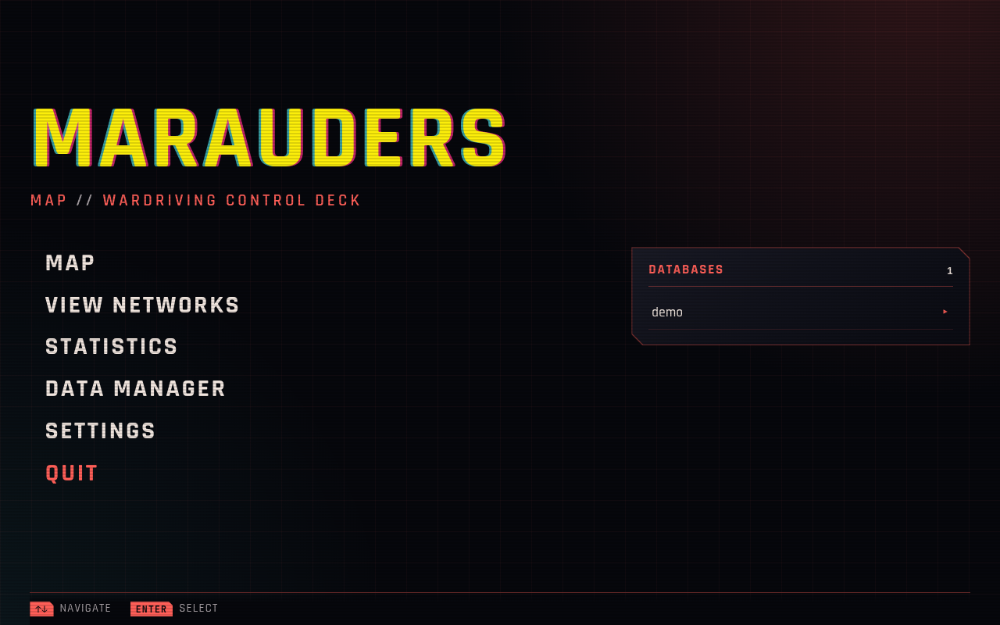 | 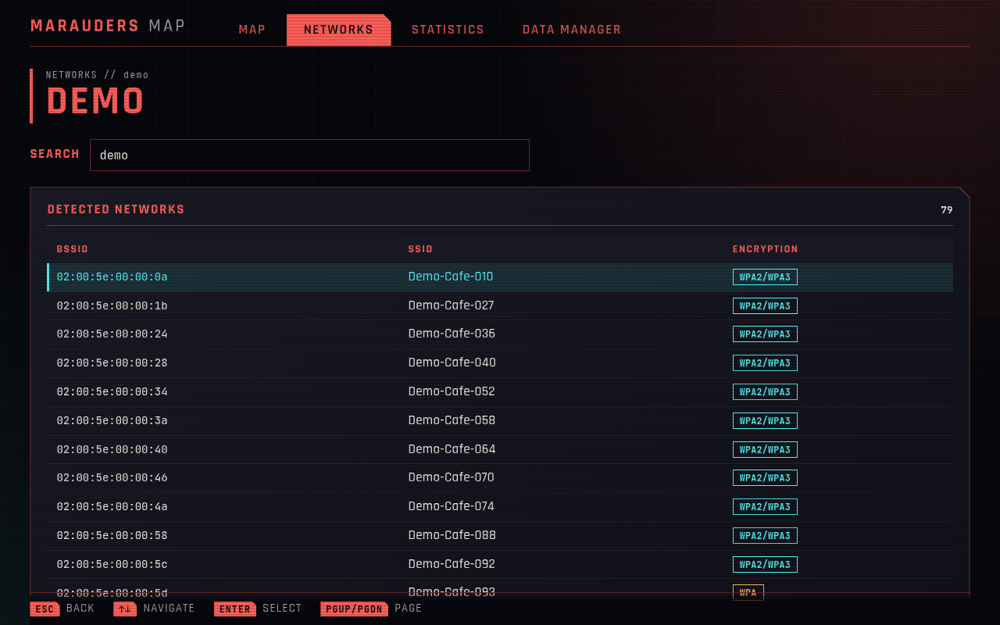 |

| GUI: map with clusters and encryption filter | GUI: statistics |
| --- | --- |
| 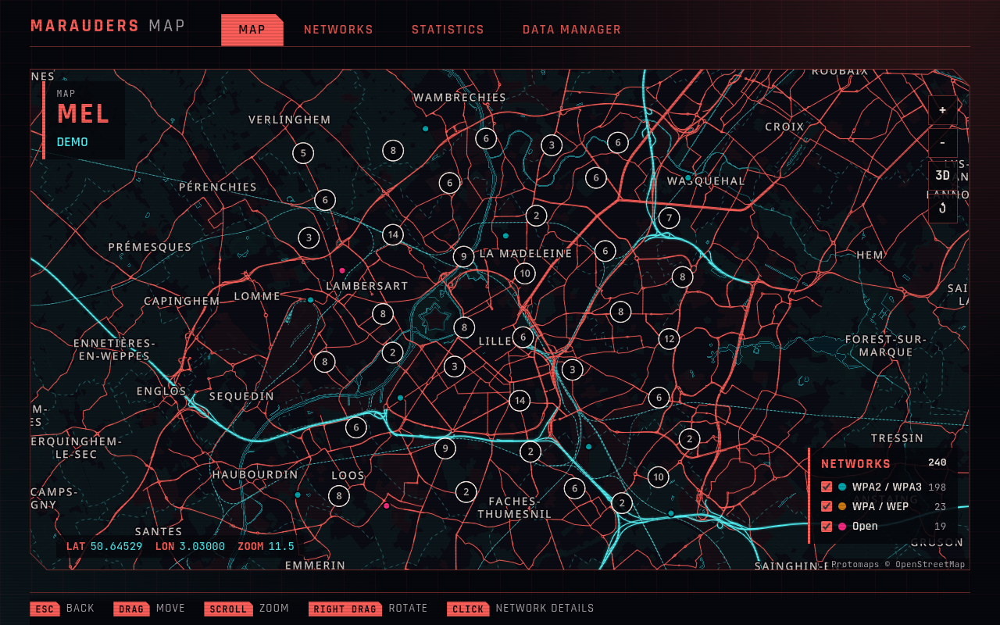 | 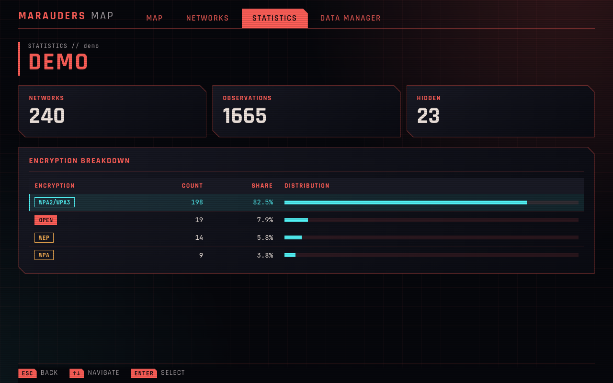 |

| GUI: import dialog | TUI: network list |
| --- | --- |
| 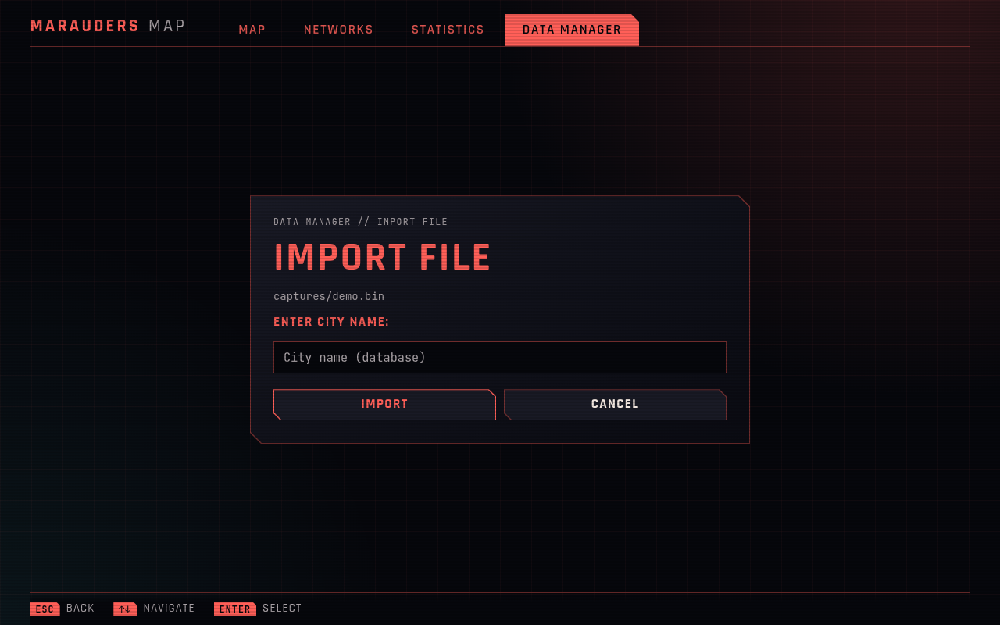 | 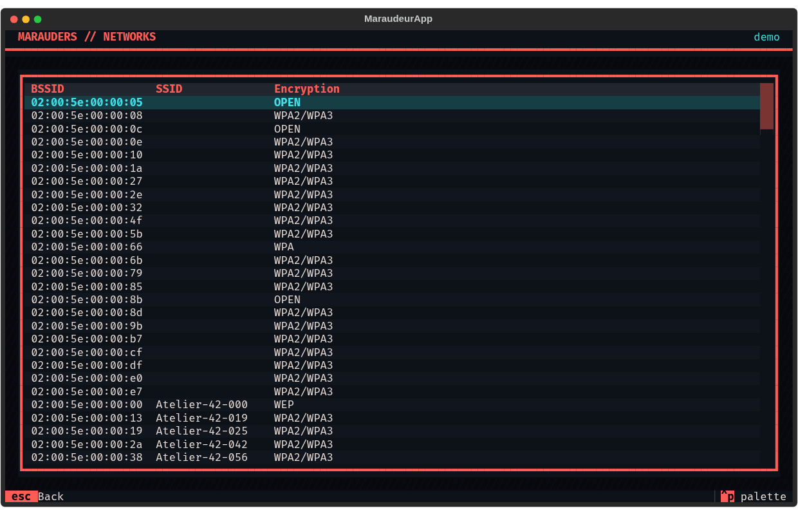 |

| TUI: main menu | TUI: statistics |
| --- | --- |
| 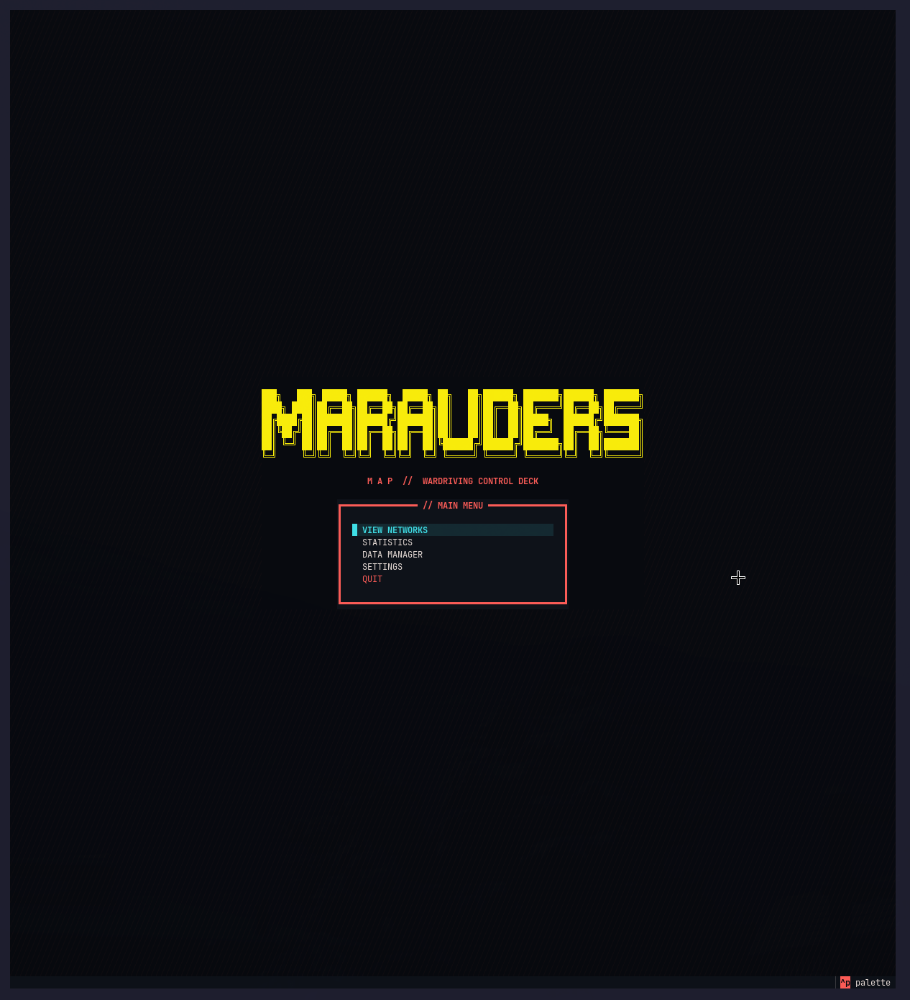 | 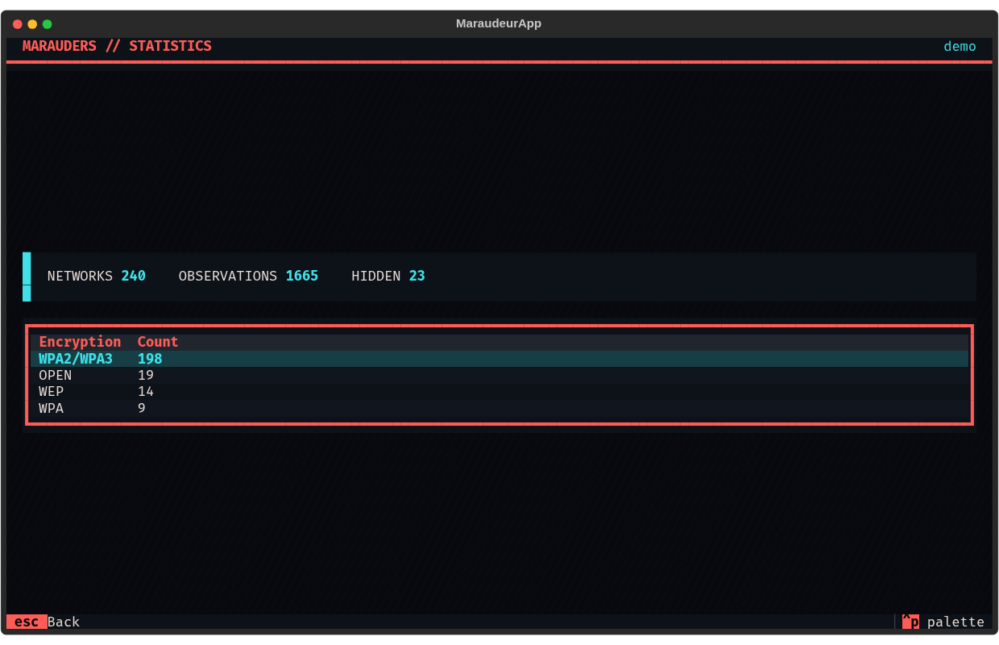 |

### 2.5 Navigation map

The two interfaces follow the same structure. The GUI adds the Map entry.

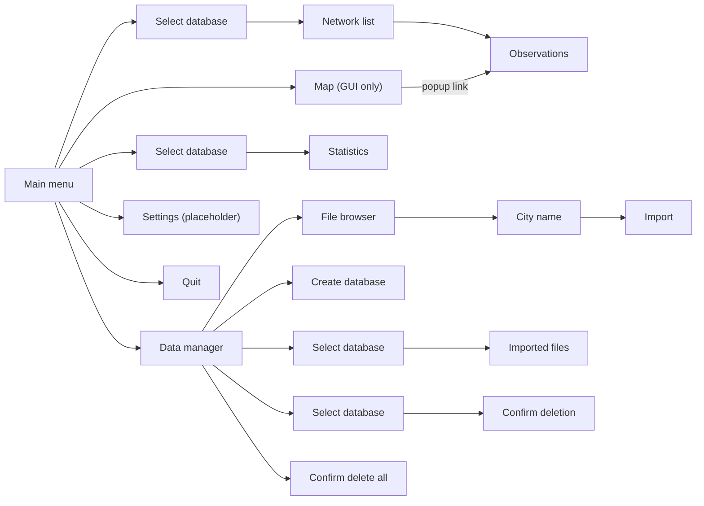

---

## 3. System architecture

### 3.1 High-level diagram

The system has two independent halves that exchange a **file**: capture happens
in the field, and analysis happens later on a workstation.

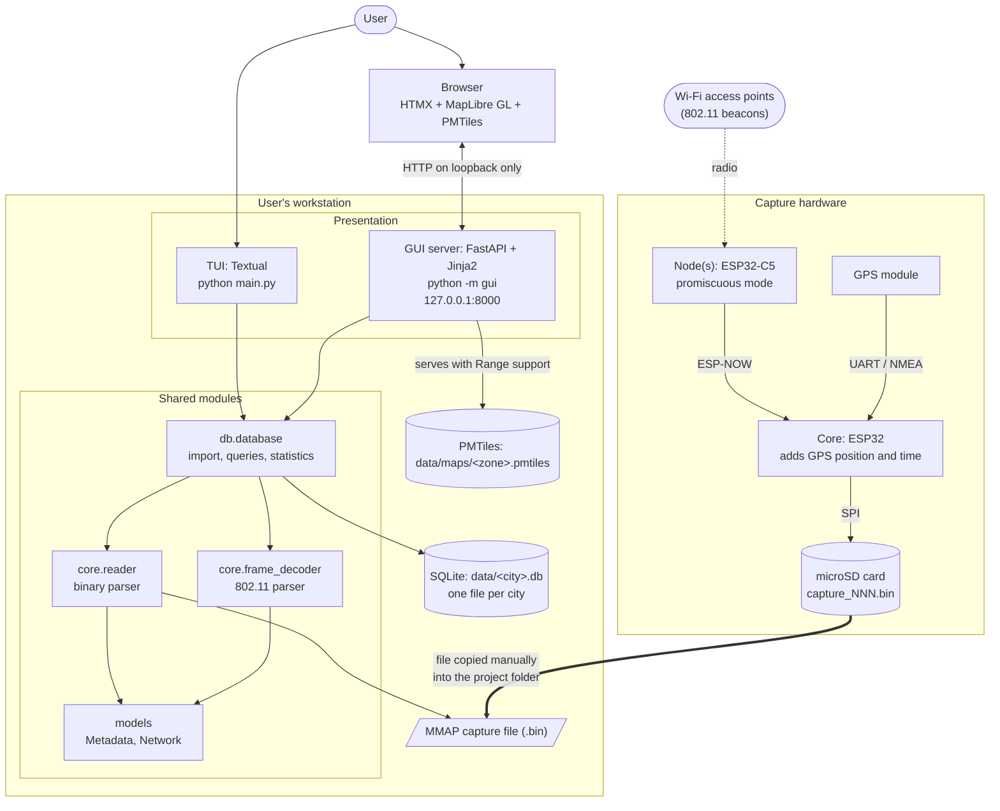

The firmware of the capture hardware is not in this repository. On the workstation,
the TUI and the GUI server run as separate processes and everything stays local.

### 3.2 Layers and dependency rules

| Layer | Packages | Rule |
| --- | --- | --- |
| Presentation | `tui/`, `gui/` | Handles display and user input. The two interfaces never depend on each other. |
| Persistence and use cases | `db/` | Owns SQL and the import workflow. Knows nothing about the interfaces. |
| Decoding | `core/` | Pure parsing of bytes. Performs no database access. |
| Data model | `models/` | Plain dataclasses, with no dependency on other project packages. |

The TUI does not call the HTTP server: both interfaces import `db.database`
directly. Each one therefore runs alone, with no daemon to start first.

### 3.3 Deployment view

There is no build or deployment pipeline. Installation is a Python virtual
environment and the dependencies pinned in `requirements.txt`.

```bash
python -m venv .venv
.venv/bin/pip install -r requirements.txt
mkdir -p data/maps

.venv/bin/python main.py      # terminal interface
.venv/bin/python -m gui       # http://127.0.0.1:8000 (--port to change)
```

- **Working directory:** commands must run from the project root, because `data/`
  is a relative path.
- **Runtime data:** `data/<city>.db` and `data/maps/*.pmtiles` are not versioned.
- **Stopping the GUI:** the **Quit** menu item calls `POST /quit`, which stops the
  server. The GUI has no background service.

### 3.4 Security boundary

The GUI has no login, so its security relies on staying local. Even so, any
website open in the same browser could try to reach `127.0.0.1`, and SSIDs are
untrusted text received over the air. Protections are therefore in place:

| Threat | Protection | Location |
| --- | --- | --- |
| Access from another machine | Server bound to `127.0.0.1` only | `gui/__main__.py` |
| DNS rebinding | `TrustedHostMiddleware` allows `localhost` and `127.0.0.1` | `gui/app.py` |
| Cross-site request forgery on destructive actions | Non-safe requests with a foreign `Origin` or `Sec-Fetch-Site: cross-site` get `403` | `gui/app.py` |
| Malicious SSID (HTML or script) | Jinja2 autoescaping, a strict Content Security Policy, `textContent` in map popups | `gui/app.py`, `gui/static/js/map.js` |
| Malicious SSID (terminal markup) | Cells wrapped in `rich.text.Text` in the TUI, so markup is not interpreted | `tui/screens/` |
| Path traversal | File browser limited to the launch folder; city names validated | `gui/routes/data_manager.py`, `gui/common.py` |
| SQL injection | Parameterized queries | `db/database.py` |

City name validation exists only in the GUI, see defect D5.

---

## 4. Components, classes and database design

### 4.1 Components

| Component | Files | Responsibility |
| --- | --- | --- |
| Capture reader | `core/reader.py` | Validates the header and streams `(Metadata, frame)` pairs |
| Frame decoder | `core/frame_decoder.py` | Extracts BSSID, SSID and encryption from a beacon frame |
| Models | `models/metadata.py`, `models/network.py` | Dataclasses exchanged between layers |
| Database access | `db/database.py` | Schema, import workflow, queries, statistics, file deletion |
| TUI application | `tui/app.py`, `tui/screens/`, `tui/widgets/`, `tui/styles.tcss`, `tui/theme.py` | Textual screen stack, widgets and theme |
| GUI application | `gui/app.py`, `gui/__main__.py` | FastAPI app, middleware, error pages, static mounts |
| GUI routes | `gui/routes/` | One router per feature: `menu`, `network`, `statistics`, `data_manager`, `map` |
| GUI helpers | `gui/common.py` | Rendering, pagination, name validation, connection management |
| GUI front-end | `gui/templates/`, `gui/static/` | Jinja2 templates, CSS, keyboard navigation (`app.js`), map (`map.js`), vendored libraries and fonts |

### 4.2 Classes and modules

The code favors modules of functions, and uses classes where they bring something:
dataclasses for data, and subclasses of Textual's `Screen` for the TUI. The
diagram shows functional modules with the `<<module>>` stereotype.

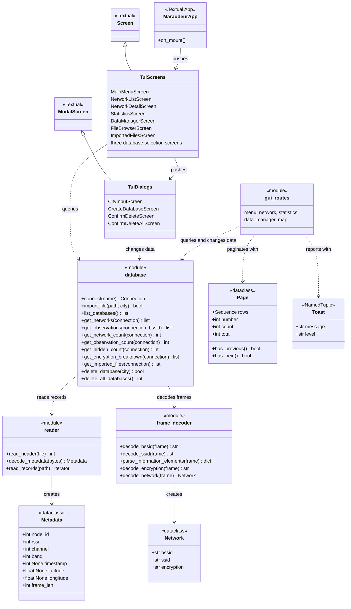

`TuiScreens`, `TuiDialogs` and `gui_routes` are groupings made for readability.
They are not classes in the code.

### 4.3 Database design

SQLite is used with **one database file per city** (`data/<city>.db`). The
application stores no data outside these files and the map archives.

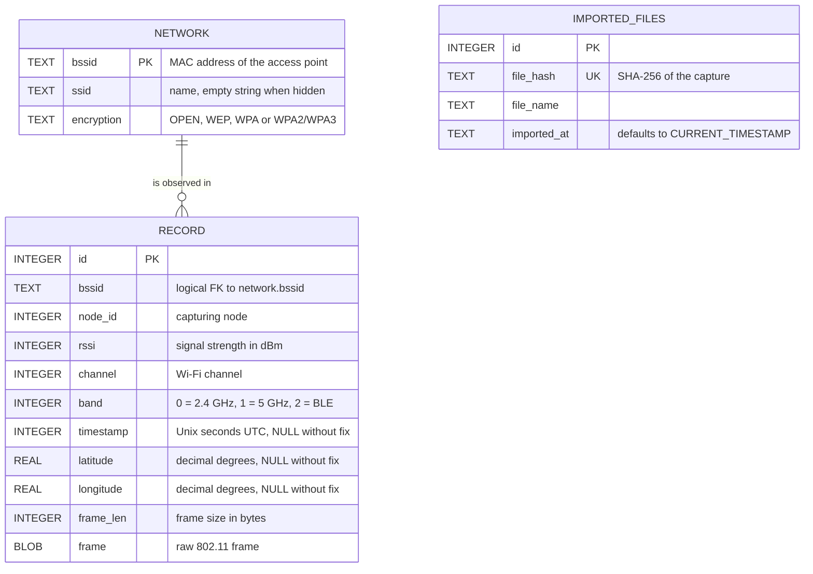

`IMPORTED_FILES` has no relationship with the other tables: it only records which
files were imported. Its rows do not link a record to its source file.

```sql
CREATE TABLE IF NOT EXISTS network (
    bssid TEXT PRIMARY KEY,
    ssid TEXT,
    encryption TEXT
);

CREATE TABLE IF NOT EXISTS record (
    id INTEGER PRIMARY KEY,
    bssid TEXT,
    node_id INTEGER,
    rssi INTEGER,
    channel INTEGER,
    band INTEGER,
    timestamp INTEGER,
    latitude REAL,
    longitude REAL,
    frame_len INTEGER,
    frame BLOB
);

CREATE TABLE IF NOT EXISTS imported_files (
    id INTEGER PRIMARY KEY,
    file_hash TEXT UNIQUE,
    file_name TEXT,
    imported_at TEXT DEFAULT CURRENT_TIMESTAMP
);
```

**Design notes**

- **Identity is separate from observations.** A network is stored once, however
  many times it is heard. Its properties do not have to be repeated in each sighting.
- **The relationship is logical.** `record.bssid` refers to `network.bssid`, but no
  `FOREIGN KEY` is declared and SQLite does not enforce it. The import writes both
  rows in the same transaction, which keeps them consistent.
- **Raw frames are kept.** A decoding error can be fixed by recomputing the stored
  frames, without the original capture. This costs space: on the reference capture,
  frames represent 39.7 MB of a 50.4 MB database.
- **A missing GPS fix is `NULL`.** The capture format uses `0`, and the reader
  converts it so that a position at 0,0 is not mistaken for real data.
- **Deduplication has two levels.** `INSERT OR IGNORE` keeps one row per BSSID,
  and the file hash prevents importing the same file twice into a database. The
  hash is checked per database, so a file can still be imported into another city.
- **Import is atomic.** All inserts share a transaction committed at the end, so a
  failure leaves no partial records.

**Observed volume** (reference capture of 83 minutes, one node, 2.4 GHz):
42.0 MB `.bin` file, 4,997 networks, 128,140 observations, of which 654 have no
GPS fix.

### 4.4 Other data structures

| Structure | Format | Reference |
| --- | --- | --- |
| Capture file | Binary: 5-byte header (`MMAP` + version), then records of 18 bytes of metadata plus a raw frame, little-endian | [Data format §1](data-format.md#1-capture-file--mmap-binary-format) |
| Beacon frame | IEEE 802.11 management frame; BSSID at offset 16, Information Elements from offset 36 | [Data format §2](data-format.md#2-80211-frame-decoding) |
| Map zone | PMTiles v3 single-file archive of vector tiles | [README, Map section](../README.md#map) |
| Map style | MapLibre style JSON | `gui/static/map/style.json` |

---

## 5. Sequence diagrams

### 5.1 Capture in the field

This flow runs in the firmware, as described in [Hardware](hardware.md).

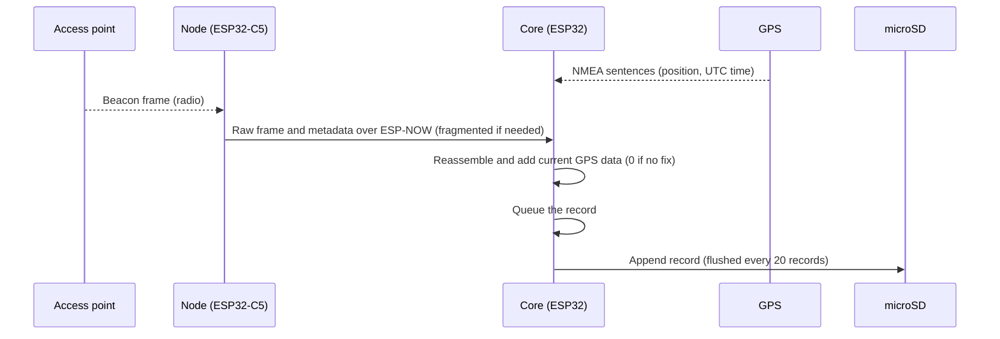

### 5.2 Importing a capture from the GUI

This is the central use case. The TUI runs the same `import_file` function from
`CityInputScreen`, but without the `try/except` shown here (defect D2).

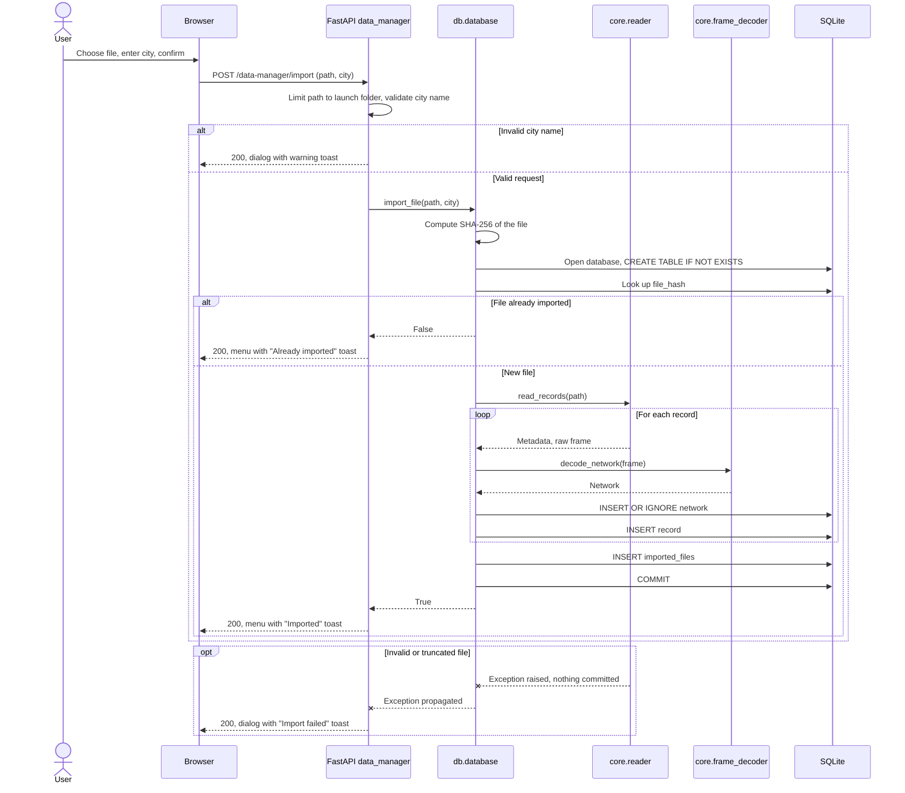

### 5.3 Displaying the map

The GUI sends two kinds of data to the browser: the network positions as GeoJSON
and the background map through HTTP Range requests on a local file. No tile
server or third-party service is involved.

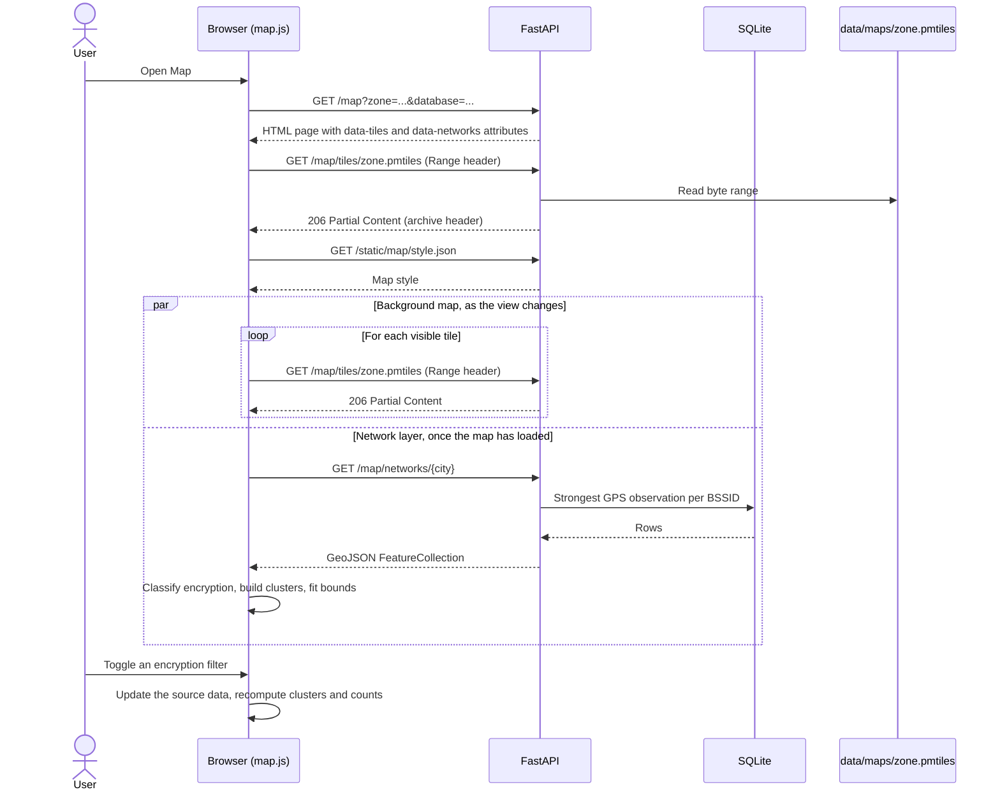

### 5.4 Searching networks with HTMX

The server keeps rendering the HTML and the browser swaps only the results.

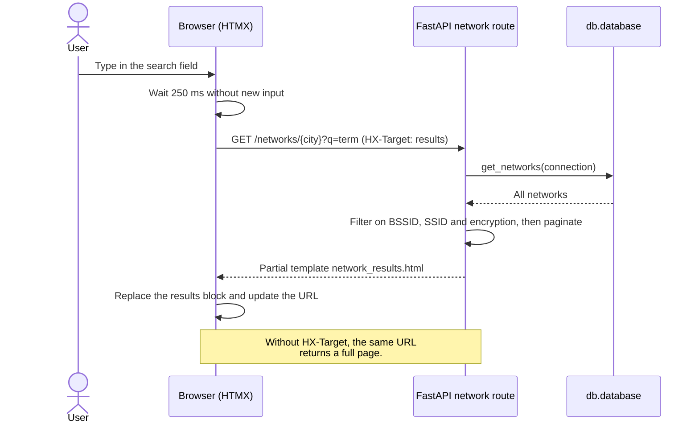

### 5.5 Browsing networks in the TUI

The TUI has no HTTP layer. Navigation is a stack of screens calling `db.database`
in the same process.

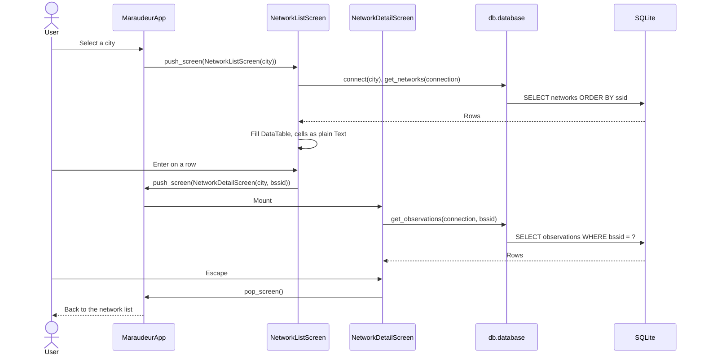

### 5.6 Blocking a destructive request from another site

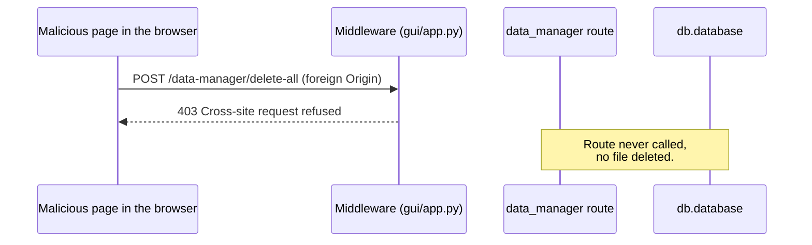

---

## 6. API specifications

### 6.1 External APIs

**The application calls no external API at runtime.** The Content Security Policy
(`default-src 'self'`) also stops the pages from loading third-party resources.
JavaScript libraries and fonts are stored in `gui/static/`.

Third-party services are only used by hand, at setup time:

| Service or tool | Use | When | Data sent |
| --- | --- | --- | --- |
| [Protomaps builds](https://build.protomaps.com) with the [`pmtiles` CLI](https://github.com/protomaps/go-pmtiles) | Downloading a map zone derived from OpenStreetMap | Once per zone, run manually | The requested bounding box |
| PyPI | Installing Python dependencies | At installation | None specific to the user |

### 6.2 Internal HTTP interface (GUI)

**Base URL:** `http://127.0.0.1:8000` (port configurable with `--port`).
**Authentication:** none, see [§3.4](#34-security-boundary).

This is an interface for the application's own front-end, not a public REST API.
It is **HTML-first**: routes return full pages or HTML fragments, and only the map
data is JSON. Swagger and OpenAPI generation are disabled (`docs_url`, `redoc_url`
and `openapi_url` are set to `None`), since no external client is expected.

#### General behavior

| Case | Behavior |
| --- | --- |
| `Host` other than `localhost` or `127.0.0.1` | `400` plain text |
| Non-safe method with foreign `Origin` or `Sec-Fetch-Site: cross-site` | `403` plain text |
| Unknown database, network, file or route | `404` HTML error page |
| SQLite `OperationalError` | `500` HTML error page |
| Form validation error (`POST`) | `200` with the dialog again and a warning toast |
| Response headers | `Content-Security-Policy`, `X-Content-Type-Options: nosniff`, and `Cache-Control: no-store` outside static files and tiles |
| HTMX | Sending `HX-Target: results` returns only the table fragment. Some `POST` responses set `HX-Push-Url` to correct the address bar. |

#### Menu

| Method | Path | Parameters | Response |
| --- | --- | --- | --- |
| `GET` | `/` | — | Main menu with the list of databases |
| `GET` | `/settings` | — | Placeholder page |
| `POST` | `/quit` | — | Confirmation page, then the server stops |

#### Networks

| Method | Path | Parameters | Response |
| --- | --- | --- | --- |
| `GET` | `/networks` | — | Database selection |
| `GET` | `/networks/{city}` | Query: `q` (text, default empty), `page` (default 1) | Paginated list, or fragment with `HX-Target: results`. `404` for an unknown city. |
| `GET` | `/networks/{city}/{bssid}` | Query: `page` (default 1) | Network observations, or fragment. `404` for an unknown city or BSSID. |

Out-of-range page numbers are moved to the nearest valid page. Each page holds
50 rows.

#### Statistics

| Method | Path | Parameters | Response |
| --- | --- | --- | --- |
| `GET` | `/statistics` | — | Database selection |
| `GET` | `/statistics/{city}` | — | Totals and encryption breakdown. `404` for an unknown city. |

#### Map

| Method | Path | Parameters | Response |
| --- | --- | --- | --- |
| `GET` | `/map` | Query: `zone`, `database` (optional, unknown values fall back to the first available) | Map page, or a "No map zone" message page |
| `GET` | `/map/networks/{city}` | — | GeoJSON (below). `404` for an unknown city. |
| `GET` | `/map/tiles/{zone}.pmtiles` | `Range` header | `206` with the requested bytes. `404` for an unknown zone. |

Example response of `GET /map/networks/{city}`, the only JSON data endpoint
(synthetic data, one feature shown):

```json
{
  "type": "FeatureCollection",
  "features": [
    {
      "type": "Feature",
      "geometry": { "type": "Point", "coordinates": [3.0065913, 50.6320134] },
      "properties": {
        "bssid": "02:00:5e:00:00:00",
        "ssid": "Atelier-42-000",
        "encryption": "WEP",
        "rssi": -49,
        "observations": 9
      }
    }
  ]
}
```

Coordinates follow the GeoJSON order (longitude, latitude). `rssi` is the strongest
value with a GPS fix, and `observations` counts the observations with a GPS fix.
Networks with no GPS observation are omitted.

#### Data manager

| Method | Path | Parameters | Response |
| --- | --- | --- | --- |
| `GET` | `/data-manager` | — | Data manager menu |
| `GET` | `/data-manager/import` | Query: `path` (default `.`) | File browser, limited to the launch folder. `404` outside it. |
| `GET` | `/data-manager/import/file` | Query: `path` (required) | Import dialog. `404` if the file is missing or out of bounds. |
| `POST` | `/data-manager/import` | Form: `path`, `city` | Menu with a success or "already imported" toast; dialog with a toast on validation or import failure |
| `GET` | `/data-manager/create` | — | Creation dialog |
| `POST` | `/data-manager/create` | Form: `city` | Menu with toast; dialog with a toast if invalid or already existing |
| `GET` | `/data-manager/imported` | — | Database selection |
| `GET` | `/data-manager/imported/{city}` | — | Imported files. `404` for an unknown city. |
| `GET` | `/data-manager/delete` | — | Database selection |
| `GET` | `/data-manager/delete/{city}` | — | Confirmation dialog. `404` for an unknown city. |
| `POST` | `/data-manager/delete/{city}` | — | Deletes the file, menu with toast. `404` for an unknown city. |
| `GET` | `/data-manager/delete-all` | — | Confirmation dialog |
| `POST` | `/data-manager/delete-all` | — | Deletes all databases, menu with toast |

#### Static resources

| Path | Content |
| --- | --- |
| `/static/*` | CSS, JavaScript, fonts, vendored libraries, map style and glyphs |

### 6.3 Internal Python API (TUI and GUI)

The TUI has no endpoints: its equivalent is this set of functions, shared with the
GUI. All the functions below are in `db/database.py`, except where noted.

| Function | Input | Output | Notes |
| --- | --- | --- | --- |
| `import_file(path, city)` | `Path`, `str` | `bool`: `True` if imported, `False` if already imported | Raises an exception on invalid data |
| `connect(database_name)` | `str` | `sqlite3.Connection` | Creates the file if it does not exist |
| `list_databases()` | — | `list[str]` | Files `data/*.db` |
| `get_networks(connection)` | connection | rows `(bssid, ssid, encryption)` | Sorted by SSID |
| `get_observations(connection, bssid)` | connection, `str` | rows `(timestamp, latitude, longitude, rssi)` | Sorted by time |
| `get_network_count(connection)` | connection | `int` | |
| `get_observation_count(connection)` | connection | `int` | |
| `get_hidden_count(connection)` | connection | `int` | Empty SSIDs |
| `get_encryption_breakdown(connection)` | connection | rows `(encryption, count)` | Most frequent first |
| `get_imported_files(connection)` | connection | rows `(file_name, imported_at)` | |
| `delete_database(city)` | `str` | `bool` | Deletes the file permanently |
| `delete_all_databases()` | — | `int` | Number of deleted files |
| `core.reader.read_records(path)` | `str` or `Path` | generator of `(Metadata, bytes)` | `ValueError` if the header is invalid |
| `core.frame_decoder.decode_network(frame)` | `bytes` | `Network` | Assumes a beacon frame |

### 6.4 TUI commands

| Key | Action |
| --- | --- |
| `↑` / `↓` | Move in a menu or table |
| `Enter` | Select |
| `Esc` | Go back or cancel |
| `Ctrl+P` | Textual command palette |

---

## 7. SCM and QA plans

### 7.1 Source control management

**Current practice**

| Topic | Practice |
| --- | --- |
| Tool and hosting | Git, GitHub |
| Branching | Solo development on `main` (33 commits at this baseline) |
| Commit messages | Conventional Commits types: `feat:`, `build:`, `docs:`, `styles:` |
| Excluded from Git | `data/`, `data_tests/`, `.venv`, `.env`, IDE files, personal notes |
| Dependencies | Exact versions pinned in `requirements.txt` |
| Vendored code | Front-end libraries and fonts stored in `gui/static/` with their licenses |

Excluding `data/` and `data_tests/` is a privacy decision as well as a size one:
captures and databases link networks to precise places and times.

**Plan from this baseline**

Trunk-based development suits a single developer, and short-lived branches
add a review and CI checkpoint at low cost:

1. Create one branch per change from `main`: `feat/…`, `fix/…`, `docs/…`.
2. Open a pull request, with CI required to pass before merging.
3. Keep Conventional Commits.
4. Tag releases with semantic versions (`v0.1.0` for the first school delivery).
5. Keep a `CHANGELOG.md` generated from the commit types.

### 7.2 QA: current state

**The repository has no automated tests and no CI yet.** QA has been manual so far,
through both interfaces and the `__main__` blocks of `core/` and `db/` on a local
capture. The plan in [§7.4](#74-qa-plan) addresses this gap.

### 7.3 Verification performed for this document

The statements in this document were checked on **5 November 2026** by running the
baseline code with Python 3.15.2 and Chromium, in a temporary folder outside the
project. The inputs were a synthetic capture (240 networks, 1,665 observations) and
malformed variants of it. Timings use the reference capture, with the resulting
database written to the temporary folder.

| Area | Check | Result |
| --- | --- | --- |
| Import | New file, then the same file again | ✅ Imported, then skipped |
| Import | Invalid magic bytes (GUI) | ✅ Error toast; ⚠️ empty database left behind (D2) |
| Import | Invalid magic bytes (TUI) | ❌ Application exits with an error (D2) |
| Import | Truncated file | ⚠️ Whole file refused, no record kept (D3) |
| Import | Header only, no records | ✅ Valid, 0 records |
| Performance | 42 MB, 128,140 records, RAM-backed storage | Import in about 0.7 s, duplicate check in about 0.02 s |
| Routes | All documented `GET` routes, plus `404` cases | ✅ Expected status codes |
| Routes | Search, `HX-Target` fragment, GeoJSON, `206` tile response | ✅ |
| Routes | Delete and quit | ✅ |
| Security | Foreign `Host` | ✅ `400` |
| Security | Foreign `Origin`, `Sec-Fetch-Site: cross-site` | ✅ `403` |
| Security | Path traversal in the file browser, `../evil` as city (GUI) | ✅ `404`, refused |
| Security | `../escape` as city (TUI) | ❌ File created outside `data/` (D5) |
| GUI | Rendering of every main view in Chromium, including the map | ✅ See [§2.4](#24-mockups) |
| TUI | Navigation with the Textual test pilot | ✅ Lists and detail filled |
| TUI | Empty database, then statistics | ❌ Application exits with an error (D4) |

The real-time rendering of the TUI in a terminal and browsers other than Chromium
were not part of this verification.

### 7.4 QA plan

**Objectives**

- Protect decoding and import, where an error silently corrupts the results.
- Turn each known defect into a regression test before fixing it.
- Keep tests fast, offline and free of real capture data.

**Test levels and tools**

| Level | Scope | Tool | Priority |
| --- | --- | --- | --- |
| Unit | `core.reader`, `core.frame_decoder` with hand-built bytes | `pytest` | 1 |
| Integration | `import_file` and queries on temporary databases | `pytest`, `tmp_path` | 1 |
| HTTP | Routes, status codes, middleware, partial rendering | FastAPI `TestClient` | 2 |
| TUI | Screen navigation and dialogs, headless | Textual `run_test()` pilot | 3 |
| Static | Lint and formatting | `ruff` | 2 |
| Manual | Map rendering and keyboard navigation in a browser, a real terminal | Checklist before each release | 3 |

**Test data:** a small synthetic capture generated by a script and versioned in
`tests/fixtures/`. It contains only fake networks, and replaces the ignored
`data_tests/` folder in automated tests.

**Priority test cases**

| ID | Level | Scenario | Expected result | Covers |
| --- | --- | --- | --- | --- |
| T-01 | Unit | Metadata with timestamp `0` | Timestamp and position are `None` | US-04 |
| T-02 | Unit | Negative coordinates | Correct division by 1e7 | US-04 |
| T-03 | Unit | Each encryption type | `OPEN`, `WEP`, `WPA`, `WPA2/WPA3` | US-03 |
| T-04 | Unit | WPA element followed by another vendor element | `WPA` | D1 |
| T-05 | Unit | Hidden SSID, invalid UTF-8 | Empty string, replacement characters | US-03 |
| T-06 | Unit | Invalid header, header only, truncated record | Controlled error or empty result | D3 |
| T-07 | Integration | Importing the same file twice | Second import refused, row counts unchanged | US-02 |
| T-08 | Integration | Failure in the middle of an import | No rows committed, file can be re-imported | US-01 |
| T-09 | Integration | Invalid file | No database created | D2 |
| T-10 | Integration | Newly created database, then statistics | Zeros, not an error | D4 |
| T-11 | HTTP | Foreign `Origin`, foreign `Host` | `403`, `400`, no change to data | §3.4 |
| T-12 | HTTP | Path traversal in `path` and `city` | Refused, no file created | §3.4, D5 |
| T-13 | HTTP | SSID containing `<script>` | Escaped in the output | §3.4 |
| T-14 | HTTP | GeoJSON with and without GPS fixes | Valid structure, unlocated networks omitted | US-08 |
| T-15 | TUI | Invalid file in the import dialog | Notification, application still running | D2 |
| T-16 | TUI | Opening the delete-all dialog | Focus on `Cancel` | D6 |

**Continuous integration (planned):** a GitHub Actions workflow runs `ruff` and
`pytest` on each pull request, with the same Python version as development.

**Definition of done**

- Tests pass locally and in CI, with no new lint errors.
- A bug fix includes a test that failed before the fix.
- Coverage target: 80% for `core/` and `db/`. Interface code is judged by its
  scenarios, not by a percentage.
- A change to the interfaces is checked in both TUI and GUI when it applies to both.

**Defect management:** defects are tracked as GitHub Issues with a severity. High
severity defects (wrong data or data loss) are fixed before new features.

---

## 8. Technical justifications

### 8.1 Why a standalone application

| Reason | Detail |
| --- | --- |
| Data sensitivity | Databases link networks to precise places and times, and should stay with their owner |
| Usage | One person analyzes files they recorded, with no need for sharing or concurrent access |
| Field conditions | The tool must work without connectivity |
| Simplicity | No hosting, accounts or attack surface exposed to the internet |

**Trade-off:** no access from other devices and no sharing. Exports are planned to
cover a part of this need.

### 8.2 Technology choices

| Decision | Why | Alternatives considered | Accepted cost |
| --- | --- | --- | --- |
| **Python** for the application | Fast iteration for a proof of concept. Good fit for binary parsing (`struct`) and `sqlite3` in the standard library. Gives access to Textual. | **Rust**: the repository started as an empty Rust skeleton and moved to Python at commit `48f19a8`; more development effort for a tool where import time is not critical. | Slower than native code, although the reference capture imports in under a second |
| **Textual** for the TUI | Rich widgets (tables, trees, dialogs), CSS-like styling, a built-in test pilot | **curses**: much lower-level. **Rich alone**: display without an interactive application model. | A sizable dependency |
| **Two interfaces** over shared modules | Terminal for quick, keyboard-driven use; a browser is required for the map | **GUI only**: loses the terminal workflow. **TUI calling the HTTP server**: requires a running server for no benefit. | Each feature is written twice, and some logic is duplicated today |
| **FastAPI + Uvicorn** | Lightweight routing and validation, with plain `def` routes run in a thread pool, which suits blocking `sqlite3` calls | **Flask**: also suitable. **Django**: its ORM, admin and accounts would go unused. | Its OpenAPI generation is disabled and its async support is barely used here |
| **Jinja2 + HTMX** instead of a SPA | The server owns the rendering, there is no build step, little JavaScript, and normal URLs still work | **React or Vue**: a separate build, duplicated state and a JSON API for a local tool | Less suited to very rich client state, which only the map needs |
| **Vanilla JS for the map** | `map.js` wraps MapLibre directly | A front-end framework | Manual DOM handling |
| **SQLite** | Serverless, file-based, in the Python standard library. A file per city is easy to copy or delete. Relational data with a stable structure. | **PostgreSQL/PostGIS**: a server to install, and its geospatial power is not needed yet. **MongoDB**: the data is regular and relational, so a document store brings little. | One writer at a time, and no cross-database queries without extra work |
| **One database per city** | Natural organization, simple deletion, contained file size | **One database with a `city` column**: better for global search | No global view today |
| **Raw SQL** with no ORM | Few, simple queries, full control, and it fits the learning goal | **SQLAlchemy**: more abstraction than this schema needs | No automatic migrations |
| **Custom binary format (MMAP)** | Compact, with low overhead for a microcontroller, simple streaming, keeps the frame intact | **CSV**: bulky, and awkward for binary frames. **PCAP**: standard, but needs an extra convention for the GPS and context data. | A dedicated parser, and no direct compatibility with other tools |
| **Decoding on the workstation** | Keeps firmware simple, and a decoder fix can apply to existing data | Decoding on the ESP32: loses raw data and makes fixes harder | More storage on the SD card and in the database |
| **PMTiles + MapLibre GL** | A single file, served by plain HTTP Range requests, vector rendering and a custom style, works offline | **Google Maps or Mapbox**: online, an API key, and location context sent to a third party. **Public OSM tiles**: online. **MBTiles**: needs a tile server. | A zone must be downloaded in advance (about 56 MB for the Lille metropolitan area) |
| **Vendored front-end libraries** | Works offline and allows a strict CSP | **CDN**: requires network access and a third-party trust | Manual updates |
| **ESP-NOW between Node and Core** | Direct wireless link, no access point needed, and it keeps the GPS and storage on a single unit | **Wired link**: restricts node placement | Fragmentation and reassembly for large frames, with v2 of the protocol raising the limit |

### 8.3 Design choices

| Decision | Why | Trade-off |
| --- | --- | --- |
| Network identity separated from observations | Avoids repeating network data and matches its natural one-to-many structure | Requires a join or aggregation for per-network summaries |
| SHA-256 file hash for deduplication | Independent of the file name, reliable and simple | Needs reading the whole file, which is negligible here (0.02 s for 42 MB) |
| A single transaction per import | Atomic and fast, with no partial state | A single bad record rejects the whole file, see D3 |
| Network placed at its strongest GPS observation | Simple and explainable. The strongest signal suggests where the receiver was closest. | It shows where a network was **heard**, not where the access point is. A signal-weighted average is an option for later. |
| Filtering GeoJSON data rather than map layers | Cluster counts then reflect only the visible networks | The source is rebuilt on each filter change |
| Local binding with no authentication | Single-user tool, and a login screen would add little for a loopback service | The server must never be exposed on another interface |
| Keyboard-first navigation in both interfaces | Consistent use across TUI and GUI | Requires custom JavaScript in the GUI |

---

## 9. Known limitations and next steps

### 9.1 Known defects

All of these were observed or confirmed during the verification in
[§7.3](#73-verification-performed-for-this-document), except where noted as coming from the code.

| ID | Severity | Defect | Effect | Planned fix |
| --- | --- | --- | --- | --- |
| D1 | High | `parse_information_elements` keeps only the last element for each ID, so a WPA element can be overwritten by another vendor element (ID 221) | WPA networks shown as WEP: in the reference capture, 17 of the 24 "WEP" networks are in fact WPA | Keep all occurrences, then recompute from stored frames |
| D2 | High | An invalid file raises an exception after the database was created | TUI exits with an error. GUI shows an error, but leaves an empty database behind | Validate before creating the database, handle the error in the TUI, and close the connection reliably |
| D3 | Medium | A truncated capture raises an exception | The whole file is rejected, including its valid records. This can happen if power is lost during capture. | Handle truncation and keep the valid records, plus a recovery tool |
| D4 | Medium | "Create database" does not create the `network` table | Network and statistics views fail until a first import: `500` page in the GUI, TUI exits with an error | A single database initialization function |
| D5 | Medium | The TUI does not validate city names | A name such as `../x` creates a file outside `data/` | Move validation from `gui/` to `db/` |
| D6 | Medium | TUI confirmation dialogs focus "Yes" by default | Two presses of Enter from `DELETE ALL` permanently delete all databases | Focus `Cancel`, as the GUI does |
| D7 | Low | `INSERT OR IGNORE` keeps the first SSID seen (from the code) | A hidden network that later reveals its name stays hidden | Update the SSID when a name appears |
| D8 | Low | Hidden count only covers empty SSIDs | 36 SSIDs made only of NUL characters in the reference capture are not counted | Normalize at import |
| D9 | Low | TUI import runs in the event handler (from the code) | The interface freezes during a long import | Use a Textual worker |

### 9.2 Technical limitations

- **WPA2 and WPA3 are grouped.** Telling them apart requires parsing the RSN AKM suites.
- **No index on `record.bssid`.** Observation lookups scan the table (about 13 ms on
  128,140 rows), which is acceptable today but will not scale indefinitely.
- **The GUI paginates in Python.** It loads all the networks for each page, which is
  fast enough at the current volume.
- **Captures must be in the launch folder** to be selected in either interface.
- **Timestamps are shown raw**, as Unix seconds.
- **Schema changes have no migration path** yet.
- **Logic is partly duplicated** between the TUI and the GUI, such as database
  creation. A shared service layer would remove this.
- **The firmware is not in this repository.** [Hardware](hardware.md) describes it.

### 9.3 Privacy and responsible use

Captured data includes the identifiers of third-party networks, linked to places
and times. For this reason, databases and captures are excluded from Git and stay
on the local machine, and this document only shows synthetic data and aggregate
figures. The legal framework for capturing and keeping such data has not been
formally reviewed. This should be done before any publication of real data.

### 9.4 Next steps

1. Fix the defects that produce wrong data or crashes (D1 to D6).
2. Add the test foundation and CI ([§7.4](#74-qa-plan)).
3. Extract a shared service layer and a single launcher (`main.py --tui` / `--gui`).
4. Add exports, WPA2/WPA3 separation and manufacturer lookup.
5. Improve network placement and add map views (path, heatmap).
